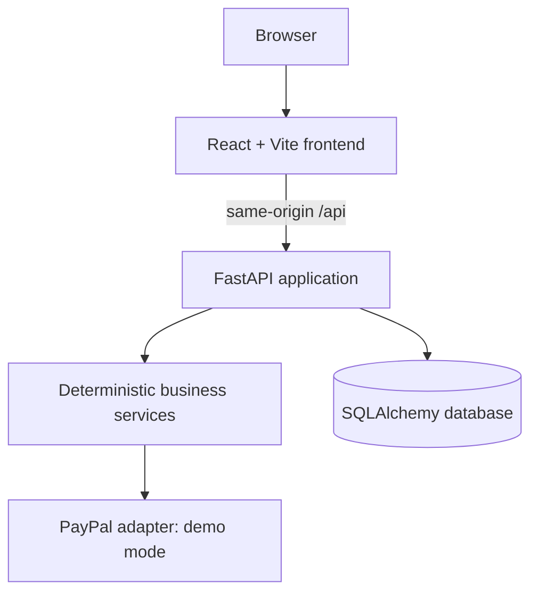

# PAYPILOT Architecture

Docker builds the React app and serves its static assets from FastAPI. This is a single-origin deployment; GitHub Pages cannot run the Python backend.

Planned production boundaries include authentication and business-level tenant isolation, integer minor-unit money storage, LLM orchestration with a strict tool allowlist, immutable approval hashes and revalidation, PayPal sandbox OAuth/webhook verification/idempotency, and append-only audit events. These are not all implemented in the current prototype.
